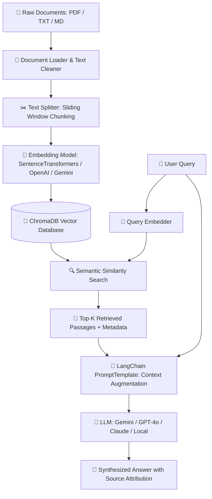

# 🧠 RAG-Based AI Chatbot using LangChain & ChromaDB

An end-to-end **Retrieval-Augmented Generation (RAG)** chatbot built with **LangChain**, **ChromaDB**, and **Streamlit**. Supports multi-LLM integration (Google Gemini, OpenAI ChatGPT, Anthropic Claude, and Offline Demo mode) with real-time PDF/document ingestion, character & recursive text chunking, and source citation.

---

## 📌 Architecture & Workflow



### Key Components:
1. **Document Loading & Preprocessing (`src/document_loader.py`)**:
   - Parses multi-page PDF documents using `pypdf`.
   - Cleans whitespaces, redundant line breaks, and extracts page-level metadata.
2. **Chunking & Splitting (`src/text_splitter.py`)**:
   - Implements configurable sliding-window character chunking (default: `500` chars with `100` chars overlap).
   - Retains page numbers, chunk identifiers, and document names.
3. **Embeddings Engine (`src/embeddings.py`)**:
   - Generates high-dimensional vector representations.
   - Compatible with `sentence-transformers` (`BAAI/bge-small-en-v1.5`), `OpenAI` (`text-embedding-3-small`), `Google Gemini`, or offline fallback.
4. **Vector Database (`src/vectorstore.py`)**:
   - Integrates **ChromaDB** with collection management, batch upserting, and cosine similarity distance calculation.
5. **RAG Pipeline & LLM Service (`src/rag_pipeline.py`)**:
   - Connects to OpenAI, Google Gemini, Anthropic Claude, or local generation.
   - Uses LangChain's `PromptTemplate` to enforce hallucination-resistant context conditioning.
6. **User Interface (`app.py`)**:
   - Interactive Streamlit dashboard with real-time file upload, index management, parameter tuning (chunk size, overlap, Top-K), and citation viewing.

---

## 🚀 Quickstart Guide

### 1. Prerequisites
- Python 3.10+
- Git

### 2. Installation
Clone the repository and install the required dependencies:
```bash
git clone https://github.com/<YOUR_USERNAME>/rag-chatbot.git
cd rag-chatbot

# Create virtual environment
python -m venv venv
# On Windows:
venv\Scripts\activate
# On Linux/macOS:
source venv/bin/activate

# Install dependencies
pip install -r requirements.txt
```

### 3. Environment Setup (Optional)
Copy `.env.example` to `.env` and insert your API keys:
```bash
cp .env.example .env
```
*(Note: You can also enter API keys directly in the Streamlit UI sidebar)*

### 4. Running the Streamlit Application
```bash
streamlit run app.py
```
Open your browser at `http://localhost:8501`.

---

## 🧪 Testing the Pipeline
You can test the entire RAG pipeline from the command line without the web UI:
```bash
python test_pipeline.py
```

---

## 🐳 Docker Deployment (Optional)

You can run the entire solution in an isolated Docker container:

```bash
# Build the Docker image
docker build -t rag-chatbot .

# Run container
docker run -p 8501:8501 rag-chatbot
```

Or run with **Docker Compose**:
```bash
docker compose up -d
```

---

## 📂 Project Structure

```
rag_project/
│── app.py                  # Streamlit Chatbot Application
│── requirements.txt        # Python package dependencies
│── Dockerfile              # Docker container specification
│── docker-compose.yml      # Docker compose configuration
│── README.md               # Detailed project documentation
│── .gitignore              # Files excluded from git tracking
│── .env.example            # Template for environment variables
│── test_pipeline.py        # Automated test verification script
│
├── src/                    # Core RAG Modules
│   ├── document_loader.py  # PDF and text extraction & cleaning
│   ├── text_splitter.py    # Sliding window chunking & metadata tagging
│   ├── embeddings.py       # Multi-provider embedding generator
│   ├── vectorstore.py      # ChromaDB storage & similarity search
│   └── rag_pipeline.py     # LangChain PromptTemplate & LLM generation
│
└── sample_docs/            # Sample documents for immediate testing
    └── transformer_paper_summary.txt
```

---

## 📝 GitHub Submission Checklist
- [x] Document loading & text splitting implementation
- [x] Embeddings generation & ChromaDB integration
- [x] Multi-LLM provider integration with LangChain prompts
- [x] Streamlit web user interface with citations
- [x] Architecture diagrams, setup guide, and documentation
- [x] Dockerfile and Docker Compose support
- [x] Ready to push to GitHub!
