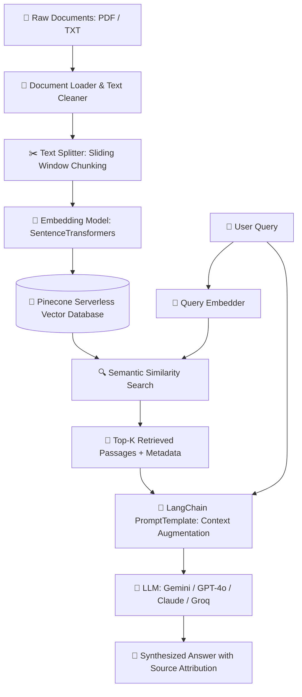

# 🧠 RAG-Based AI Chatbot using LangChain & Pinecone

An end-to-end **Retrieval-Augmented Generation (RAG)** chatbot built with **LangChain**, **Pinecone Serverless Vector Database**, and **Streamlit**. Supports multi-LLM integration (Google Gemini, OpenAI ChatGPT, Anthropic Claude, Groq, and Offline Demo mode) with real-time PDF ingestion, sliding-window text chunking, and source citation.

---

## 📌 Architecture & Workflow



### Key Components

| Module | File | Description |
|--------|------|-------------|
| Document Loader | `src/document_loader.py` | Parses multi-page PDFs with `pypdf`, cleans whitespace & extracts page metadata |
| Text Splitter | `src/text_splitter.py` | Sliding-window character chunking (default 500 chars / 100 overlap) with chunk IDs |
| Embeddings Engine | `src/embeddings.py` | Dense vector generation via `sentence-transformers` (`BAAI/bge-small-en-v1.5`) |
| Vector Store | `src/vectorstore.py` | **Pinecone Serverless** — batch upsert, cosine similarity search, index auto-creation |
| RAG Pipeline | `src/rag_pipeline.py` | LangChain `PromptTemplate` + multi-provider LLM generation |
| UI | `app.py` | Streamlit dashboard with file upload, chat, and source citation viewer |

---

## 🚀 Quickstart

### 1. Prerequisites
- Python 3.10+
- A free [Pinecone account](https://app.pinecone.io) (Serverless free tier is sufficient)

### 2. Installation

```bash
git clone https://github.com/<YOUR_USERNAME>/rag-chatbot.git
cd rag-chatbot

# Create virtual environment
python -m venv venv
venv\Scripts\activate        # Windows
# source venv/bin/activate   # Linux / macOS

pip install -r requirements.txt
```

### 3. Environment Setup

```bash
cp .env.example .env
```

Edit `.env` and add your keys:

```env
PINECONE_API_KEY=your_pinecone_api_key_here
GEMINI_API_KEY=your_gemini_api_key_here   # or GROQ / OPENAI / ANTHROPIC
```

### 4. Run

```bash
streamlit run app.py
```

Open `http://localhost:8501` in your browser.

---

## 🧪 Testing

Run the full pipeline from the command line (no UI):

```bash
python test_pipeline.py
```

---

## 🐳 Docker

```bash
# Build & run
docker build -t rag-chatbot .
docker run -p 8501:8501 --env-file .env rag-chatbot

# Or with Compose
docker compose up -d
```

---

## 📂 Project Structure

```
rag_project/
├── app.py                  # Streamlit chatbot UI
├── requirements.txt        # Python dependencies
├── Dockerfile              # Container spec
├── docker-compose.yml      # Compose config
├── .env.example            # Environment variable template
├── test_pipeline.py        # CLI pipeline test
└── src/
    ├── document_loader.py  # PDF loading & cleaning
    ├── text_splitter.py    # Chunking & metadata tagging
    ├── embeddings.py       # Embedding generation
    ├── vectorstore.py      # Pinecone vector store
    └── rag_pipeline.py     # LangChain prompt + LLM service
```

---

## ✅ Features

- [x] PDF ingestion with page-level metadata
- [x] Configurable sliding-window text chunking
- [x] Dense embeddings via `sentence-transformers`
- [x] **Pinecone Serverless** vector database (cloud-native, fully managed)
- [x] Multi-LLM support: Gemini, GPT-4o, Claude, Groq
- [x] LangChain `PromptTemplate` for hallucination-resistant answers
- [x] Source citation with document name & page number
- [x] Streamlit web UI with chat history
- [x] Docker & Docker Compose support
